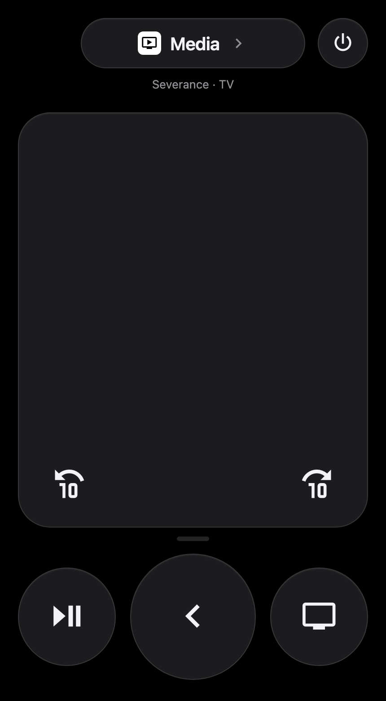

# Apple TV Remote Card (v2)

[![GitHub Release][releases-shield]][releases]
[![License][license-shield]](LICENSE)
[](https://github.com/hacs/integration)
[![GitHub Activity][last-commit-shield]][commits]

A Lovelace card for controlling an Apple TV, styled after the Apple TV Remote in the iPhone Control Center: the device name and power at the top, a large touchpad, and big round play/pause, back and Home buttons underneath.



- **Touchpad**: swipe to move, tap to select, hold to repeat, right-click or double-tap for back. Trackpad scrolling works too.
- **Resizable**: drag the grip under the touchpad to change its height (remembered per device), double-click it to reset.
- **Skip buttons on the touchpad**: skip back and forward 10 seconds appear on the touchpad while something is playing or paused.
- **Per-button devices**: any button can control its own entity, e.g. power for a shared screen, while the rest of the remote stays on the Apple TV.
- **Header**: the Apple TV's name (tap it for the media player's details), a power button, and what's playing.
- **Visual editor** and haptic feedback in the Home Assistant app.

Works with Home Assistant's [Apple TV integration](https://www.home-assistant.io/integrations/apple_tv/).

## Installation

### HACS

1. In HACS, add `https://github.com/jpnaifeh/tv-card` as a custom repository of type **Dashboard**.
2. Install **Apple TV Remote Card** and reload the browser.

### Manual

1. Copy `tv-card-v2.js` to `config/www/tv-card-v2/`.
2. Add `/local/tv-card-v2/tv-card-v2.js` as a dashboard resource of type **JavaScript module**.

## Configuration

```yaml
type: custom:tv-card-v2
remote_entity: remote.living_room
media_player_entity: media_player.living_room
```

| Name | Type | Default | Description
| ---- | ---- | ------- | -----------
| `remote_entity` | string | **Required** | The Apple TV `remote` entity that receives key presses.
| `media_player_entity` | string | | The Apple TV `media_player` entity, used for power, app buttons, now playing and showing the skip buttons only while playing or paused (without it they always show).
| `title` | string | media player name | Name shown in the header pill.
| `touchpad_height` | number | `360` | Touchpad height in px (160–720). Changing it resets any size dragged on a device.
| `buttons` | list | `[play_pause, menu, home]` | Buttons below the touchpad, in order. With three buttons the middle one is larger.
| `header_left` | string | `none` | Button to the left of the name.
| `header_right` | string | `power` | Button to the right of the name. Set to `none` to hide it.
| `enable_double_click` | boolean | unset | Unset: every tap selects and a double tap also sends back. `true`: a double tap sends only back (single taps wait 200ms). `false`: no double tap.
| `double_click_key` | string | `menu` | Command sent on double tap.
| `enable_button_feedback` | boolean | `true` | Haptic feedback in the Home Assistant app.
| `swipe_threshold` | number | `80` | Pixels of swipe per arrow key.
| `repeat_interval` | number | `400` | Milliseconds between repeats when holding on the touchpad. Higher is slower.
| `custom_keys` | object | | Extra buttons, see below.
| `custom_sources` | object | | Extra app buttons, see below.
| `custom_icons` | object | | Custom SVG icons, see below.

### Touchpad

| Gesture | Sends
| ------- | -----
| Swipe | `up` / `down` / `left` / `right`, one per `swipe_threshold` px
| Tap | `select`
| Hold still | `select`, repeated every `repeat_interval` after 700ms
| Swipe, then hold | that direction, repeated
| Double tap | `double_click_key` (see `enable_double_click`)
| Right-click | `menu`
| Scroll (trackpad / mouse wheel) | one arrow per scroll gesture

### Buttons

Built-in buttons are the Apple TV remote commands `up`, `down`, `left`, `right`, `select`, `menu`, `home`, `play_pause`, `skip_backward` and `skip_forward`, plus `power` and the apps `netflix`, `spotify` and `youtube` (these need `media_player_entity`). `power` toggles the media player, because the remote entity's own turn off only disconnects Home Assistant from the Apple TV.

`custom_keys` and `custom_sources` add buttons you can list in `buttons`. Each needs an `icon` and one of:

- `key`: a command for `remote.send_command` on the Apple TV
- `source`: an app name for `media_player.select_source`
- `service` (and optional `service_data`): any Home Assistant service

```yaml
type: custom:tv-card-v2
remote_entity: remote.living_room
media_player_entity: media_player.living_room
buttons:
  - previous
  - play_pause
  - next
  - disney
custom_keys:
  previous:
    key: previous
    icon: mdi:skip-previous
  next:
    key: next
    icon: mdi:skip-next
custom_sources:
  disney:
    source: Disney+
    icon: mdi:alpha-d-circle
```

### Per-button entities

Every button controls the card's entities by default: remote commands go to `remote_entity`, and power and apps go to `media_player_entity`. Give a button an `entity` to point it somewhere else. Built-in buttons keep their icon and behaviour, so only the `entity` is needed:

```yaml
custom_keys:
  power:
    entity: switch.living_room_screen   # toggles the screen; the Apple TV stays on
```

What `entity` means depends on the button:

| Button | `entity` should be | Called service
| ------ | ------------------ | --------------
| `power` | anything that can be turned on and off | `homeassistant.toggle`
| `key` buttons | another `remote` entity | `remote.send_command`
| `source` buttons | another `media_player` | `media_player.select_source`
| `service` buttons | the service's target | the service, with `entity` as its target

`custom_icons` maps an icon name to an SVG path, for icons that aren't in MDI:

```yaml
custom_keys:
  tv:
    key: home
    icon: appletv
custom_icons:
  appletv: "M12 2a10 10 0 1 0 0 20a10 10 0 1 0 0-20z"
```

### Styling

The card is always dark, like the iPhone remote. Override these CSS variables (for example with [card-mod](https://github.com/thomasloven/lovelace-card-mod) or a theme) to change it:

`--tv-card-background`, `--tv-card-surface`, `--tv-card-surface-active`, `--tv-card-edge-color`, `--tv-card-icon-color`, `--tv-card-secondary-text-color`, `--tv-card-border-radius`

## Upgrading from v1

v2 is a new card with a new name and config, so it doesn't replace existing `custom:tv-card` cards automatically.

- Change `type: custom:tv-card` to `type: custom:tv-card-v2`.
- Replace `entity` with `remote_entity` (and optionally `media_player_entity`).
- The row options (`power_row`, `navigation_row`, `volume_row`, …) are replaced by the touchpad and `buttons`.
- The volume slider is gone, so [slider-card](https://github.com/AnthonMS/my-cards) is no longer needed.
- `key` values in `custom_keys` are now Apple TV commands (`menu`), not `KEY_*` codes (`KEY_RETURN`).
- If you added the resource manually, point it at `tv-card-v2.js`.

v1 is still available in the git history.

## Credits

Based on [usernein's tv-card](https://github.com/usernein/tv-card), a fork of [marrobHD's tv-card](https://github.com/marrobHD/tv-card), with the touchpad originally from [iablon's Touchpad Card](https://github.com/iablon/HomeAssistant-Touchpad-Card).

[last-commit-shield]: https://img.shields.io/github/last-commit/jpnaifeh/tv-card?style=for-the-badge
[commits]: https://github.com/jpnaifeh/tv-card/commits/master
[license-shield]: https://img.shields.io/github/license/jpnaifeh/tv-card.svg?style=for-the-badge
[releases-shield]: https://img.shields.io/github/release/jpnaifeh/tv-card.svg?style=for-the-badge
[releases]: https://github.com/jpnaifeh/tv-card/releases
