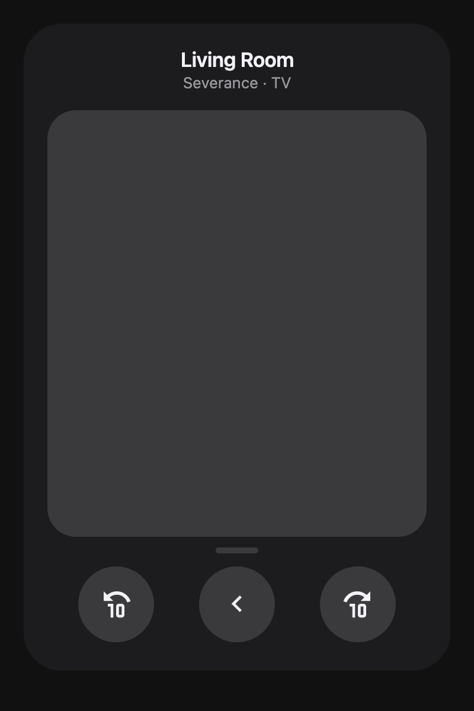

# Apple TV Remote Card (v2)

A touchpad remote for the Apple TV, styled after the Apple TV Remote in the iPhone Control Center.



```yaml
type: custom:tv-card-v2
remote_entity: remote.living_room
media_player_entity: media_player.living_room
```

**Upgrading from v1?** v2 uses a new card type (`custom:tv-card-v2`) and config. See the [README](https://github.com/jpnaifeh/tv-card/blob/master/README.md#upgrading-from-v1) for details.
